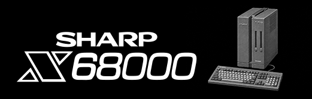

# Sharp X68000 for the Analogue Pocket

An iconic Japanese computer, now on the Analogue Pocket. Here's what you can expect:

- High compatibility with the computer's extensive library of floppy disk games
- The core will auto change disks for you!
- Multiple input and controller options

There's a lot of cool things this core can do, but there are some complexities
that mostly result from the original device being a fully fledged PC. This
README covers the details, but here's the short version:

- The X68000 is known for its accurate arcade ports – these and other arcade-style games have standard controller inputs and play well on the Analogue Pocket
- Other games are really designed for a PC. The core has options for mapping common keyboard keys to the Analogue Pocket's buttons, but mileage will vary per game. Mouse input is not currently supported.
- The core will auto detect between using the standard two button controller and a Mega Drive style three button controller. Six button controller input works too, but this generally requires changing an in-game controller setting. So if you do this, the controller option in the core itself should be updated to match
- It was common for X68000 games to be split across multiple floppy disks that would need to be manually swapped either at boot, or during runtime. Floppy disks can be changed from the core options, but the good news is that there's a system in place to automatically change them. Long-ish load times are to be expected for games spread across several disks.
- Hard disk images and D88 images are not supported and won't load

The core requires the X68000 boot ROM and each game needs a JSON file – this tells the Analogue Pocket how to handle a multi-file game. These can be made using the included Python script, but the recommended approach is to use Pupdate or Pocket Sync, which both have options to create them automatically.

## Installation

No game data or boot ROM comes with this core – you'll need your own.

1. Download the zip from the latest release and merge its `Cores`, `Platforms` and `Assets` folders into the ones on your Pocket's SD card.
2. Copy the X68000 boot ROM into `Assets/x68000/common/` as `boot.rom`. The MiSTer X68000 core's `boot.rom` works as it is. Or make one from MAME's `x68000.zip` – in a terminal on macOS or Linux, in the folder with the zip:
   
   ```sh
   (unzip -p x68000.zip cgrom.dat; head -c 131072 /dev/zero; unzip -p x68000.zip iplrom.dat) > boot.rom
   ```
3. Give each game a folder of its own in `Assets/x68000/common/` and put its disk images in it: `.dim`, `.xdf` or `.hdm`, up to seven – for example `Assets/x68000/common/Bubble Bobble/`.
4. Build the instance JSON files. This can be done through Pupdate or Pocket Sync, or using the Python script that comes in the core's folder. To use the script, put the SD card in your computer and run it with Python 3 using the actual path to the script on your Analogue Pocket:
   
   ```sh
   python3 /Volumes/POCKET/Cores/frazilpop.X68000/make_instances.py   # macOS
   py E:\Cores\frazilpop.X68000\make_instances.py                    # Windows
   ```
5. On the Pocket: openFPGA → Computer → X68000, and pick a game.

If the screen says **NO DISK IMAGES IN THE GAME FOLDER**, the game's folder has no disk the core can read, and **BOOT ROM NOT FOUND** means `boot.rom` couldn't be read – copy it again. If the `boot.rom` file isn't there at all, the Pocket will refuse to start the core itself.

## Disks

A lot of games are spread over several disks – the core has been designed
to swap these automatically when needed. When a game ejects a disk and asks
for another, the core puts the game's next disk in once the drive stops, or
after five seconds if it keeps running. After the last disk it goes round
to the first again, so a game that has asked for an earlier disk will still
eventually get it.

**Drive 0** and **Drive 1** in Core Settings can be used to change a disk by hand. File 1–7 are the folder's disks in name order and None leaves the drive empty. A change takes effect when the menu closes, and the menu shows what you chose there, not the disk the core has put in since. **Reset Game** starts the game over on the menu's disks.

## Saves

The X68000's settings memory (SRAM) is saved for each game in
`Saves/x68000/frazilpop.X68000/`. A game that saves to its own disk, such as Cho Ren Sha 68k's
high scores, writes to the disk image on the card.

## Controls

| Input | Action |
| --- | --- |
| D-pad | joystick |
| A | button A |
| B | button B |
| Start | the pad's RUN, and F1 on the keyboard (player 2: F2) |
| Select | the pad's SELECT |
| R | rapid shot: A pressed over and over while it's held |
| L | ESC (pauses many games) |
| X, Y | SPACE and RETURN, or the pair chosen in Keys on X, Y |

If a game asks for a number or a yes/no answer, set **Keys on X, Y** to 1, 2
or Y, N.

Some games require a mouse and this is not currently supported.

The Pocket's own menu has the usual **Display Mode** and **Controls** entries.
Under **Core Settings** there are six options:

- **Drive 0**, **Drive 1** – insert a disk by hand, File 1–7 (see Disks)
- **Pad type** – Auto, 2 buttons, Mega Drive 3, Capcom 6 or Magical 6. Auto will apply the two-button pad, or the Mega Drive pad automatically. However this value needs to be manually changed for a six-button option. This then has to be chosen in the game's configuration menu as well. With the two-button pad, R is rapid shot and L, X and Y are keys. With Mega Drive 3, R is rapid shot, Y is button C and only X and L are keys; the six-button pads use every button themselves
- **Keys on X, Y** – SPACE, RETURN (the default); 1, 2; or Y, N
- **Reset Game**
- **Diagnostic overlay** – probably best to ignore this

Note that Drive, Pad type and Keys revert to their defaults each time the core starts.

## Screen modes

The X68000 screen mode varies between games and the core is designed to match.
Games run at the machine's own refresh rate, which is 55.46 Hz for most games,
54.67 Hz for high-resolution games such as Cho Ren Sha 68k, and 61.46 Hz for
the 15 kHz arcade mode used by Final Fight and Street Fighter II. A couple of
games (Chase H.Q. and Heavy Nova) use a faster rate than the Pocket's screen
can show (62 and 65 Hz), these run at it's max speed which is 61.46 Hz. Arcade
games that run at a resolution of 384×224 are cropped to their own picture and
shown at 4:3 to the screen. Other display modes are shown in full resolution
up to 768×512.

## Technical details

- The core recreates the X68000 in hardware logic – the 68000 at 10 MHz, Sharp's CRTC with its sprite, background and graphics screens, the YM2151 and MSM6258 sound and the floppy drives – built on Puu-san's X68000 core for MiSTer, with a Pocket shell that reads each disk sector from the SD card as the game asks for it and writes it back.
- It's been checked against MAME in simulation: the boot identical access for access, the 15 kHz, high-resolution and 65,536-colour screens pixel for pixel, and Bubble Bobble's sound writes byte for byte.
- To build it yourself: `tools/bootstrap.sh`, then `sh pocket/build.sh` (Quartus Prime Lite 21.1 in Docker, about ten minutes). The finished SD card layout can be found in `pocket/dist/`, and [`tools/pocket/README.md`](tools/pocket/README.md) covers the scripts that make game files and check the core against MAME.

## Credits and licence

- **Puu-san** – the X68000 core this is built on, ported to MiSTer by **Sorgelig**, with fixes from Wark, odiaboeeu, albconde, Jamie Dickson, Jamie Blanks, Marc Roy, makigumo and David Shadoff.
- **Jorge Cwik (ijor)** – fx68k, the 68000 processor.
- **Raki (ika-musume)** – IKAOPM, the YM2151 sound chip.
- **agg23** – the Pocket utilities used for audio.
- **Analogue** – the openFPGA core framework.
- **The MAME team** – whose X68000 driver was the reference.
- Pocket port by **Frazilpop**.

GPL-3.0. [`THIRD-PARTY.md`](THIRD-PARTY.md) lists every part with its licence.

X68000 is a trademark of Sharp Corporation. This project contains no game
data, boot ROM or disk image.
